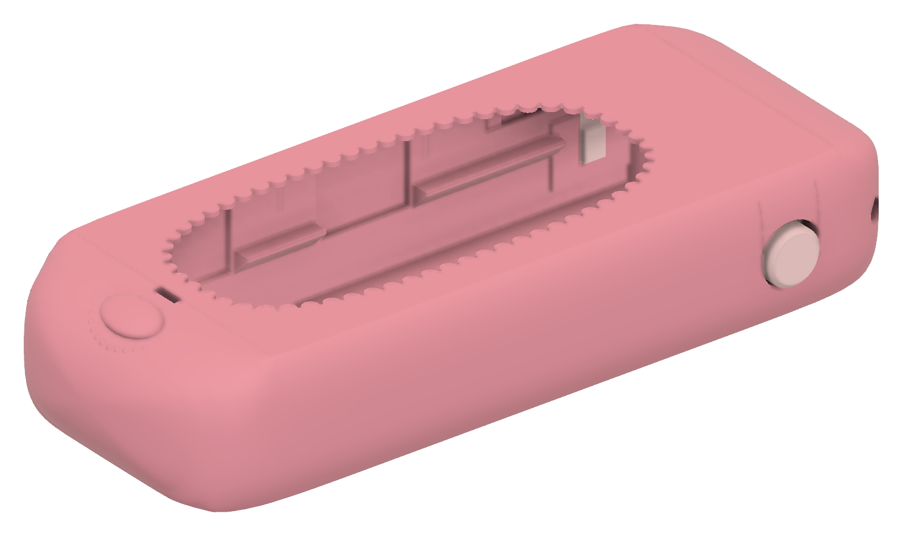
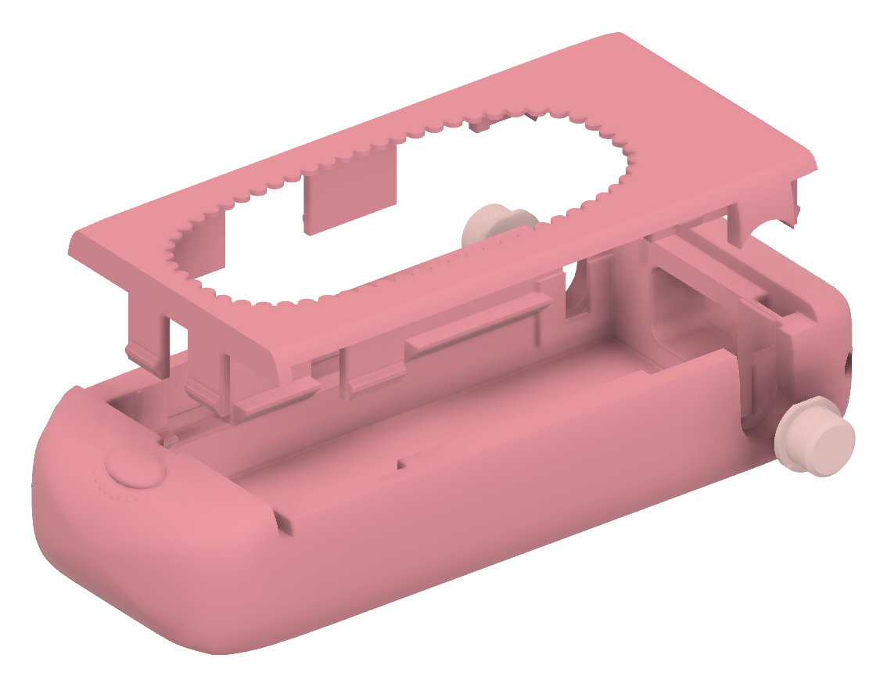
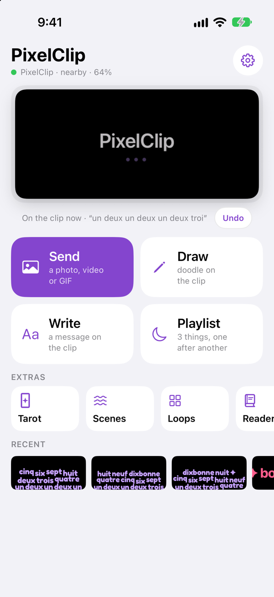
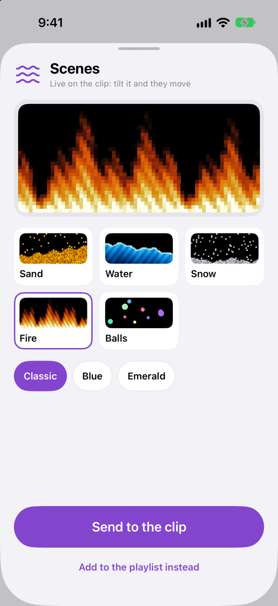
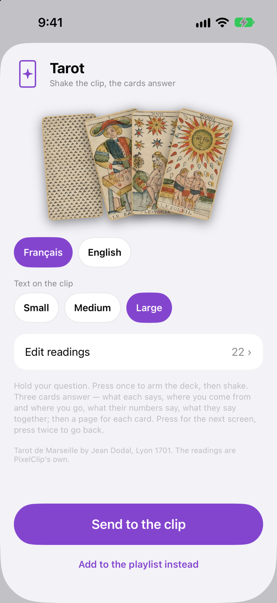

# PixelClip

A small AMOLED screen you wear as a hair clip, and the iPhone app that feeds it.

<p align="center">
  
  
</p>

PixelClip is everything you need to build one: firmware for an off-the-shelf ESP32-S3 display board, a SwiftUI
companion app, a 3-D printable case, a parts list and a build guide. The phone does the heavy work (cropping,
dithering, text rendering, encoding); the clip decompresses and shows what it is sent, runs for hours on a small
LiPo cell, and needs no internet.

<p align="center">
  
  
  
</p>

## Build one

| Step | What you do | Where to look |
|---|---|---|
| 1 | **Get the parts**: one display board, one small LiPo cell, one resistor, a hair clip | [`docs/PARTS.md`](docs/PARTS.md) |
| 2 | **Print the case**: tray, lid and two side keys in PETG, no supports | [`case/README.md`](case/README.md) |
| 3 | **Flash the firmware** over USB-C | [Build the firmware](#build-the-firmware) |
| 4 | **Prepare the board and assemble**: make room for the cell, check the battery polarity, close the case | [`docs/BUILD.md`](docs/BUILD.md) |
| 5 | **Install the app** on your iPhone and send a first picture | [Build the app](#build-the-app) |

[`docs/BUILD.md`](docs/BUILD.md) walks through all of it in order, 21 short steps from an empty bench to a clip in
your hair. No hardware yet? The app runs in the iOS simulator against a built-in virtual clip, so you can try
everything first.

**Before you start**, read [what has and has not been tested](docs/BUILD.md#what-has-and-has-not-been-tested).
This is a hobby project documented from one working clip. In particular, the board's charger must be slowed down
with a resistor change before it charges a cell this small, and that change is computed, not measured.

## What the clip can show

- **Pictures and animations** in a playlist, with cuts or fades (`.hca`, a simple RLE format for RGB565 frames).
- **Scrolling strips**: wide images that move across the screen as a marquee.
- **Live scenes** that react to movement through the on-board IMU: sand, water, snow, fire, lava, bouncing balls,
  and your own words tumbling about.
- **Reader**: speed reading of a text you send, one word at a time.
- **Tarot oracle**: shake to draw three cards (Jean Dodal's Tarot de Marseille, 1701) and read them on the clip.
- **Scheduling**: time windows and a one-shot queue ("show this at nine tonight").
- **Boards**: a list of timed row pictures that scrolls and drops rows as their time passes. The firmware and
  protocol support it; the app has no screen that builds one yet.

The phone talks to the clip over **Bluetooth LE** for small requests and over the clip's own **WiFi hotspot** for
uploads. The wire contract is [`docs/PROTOCOL.md`](docs/PROTOCOL.md).

## Hardware

- **Board**: Waveshare ESP32-S3-AMOLED-1.91, the non-touch version. ESP32-S3R8 (8 MB PSRAM), 16 MB flash, a
  1.91-inch 536 × 240 AMOLED (RM67162 over QSPI), a QMI8658C IMU, a BOOT button, USB-C, and a LiPo charger.
- **Battery**: a single-cell LiPo on the board's battery connector. Development used a protected 500 mAh cell
  (size 602040) rated for 0.5 A. Read the charge-current notes in [`docs/PARTS.md`](docs/PARTS.md) before choosing
  a cell: as shipped, the board's charger is set for about 1 A.
- **Case**: a snap-together tray and lid, about 80 × 33 × 15 mm, with two captive side keys over the board's
  buttons. No screws, no supports. STL files for printing, STEP files and the parametric Fusion script for
  editing, renders and print settings are in [`case/`](case/README.md).
- **One mismatch to know about**: the lid's window is an oval, which hides about 6 % of the picture at the four
  corners, while the firmware and app draw to the full rectangular screen. Keep important detail out of the
  extreme corners, or remix the lid with a rectangular window.

The full list with specifications is [`docs/PARTS.md`](docs/PARTS.md). Pin map, power path and panel details:
[`docs/HARDWARE.md`](docs/HARDWARE.md); board measurements: [`docs/MECHANICAL.md`](docs/MECHANICAL.md).

## Repository layout

| Path | What it is |
|---|---|
| `firmware/` | ESP-IDF v5.5 project for the clip. Details: [`firmware/README.md`](firmware/README.md) |
| `core/` | Portable C11 library shared by the firmware and the host tools (decoder, scenes, reader, oracle, board). Details: [`core/README.md`](core/README.md) |
| `tools/` | Host command-line tools (`hcaenc`, `hcadec`, `hcainfo`, previews) and test fixtures |
| `ios/` | The iPhone app (XcodeGen, Swift 6, iOS 26) and its engine package `PixelClipKit`. Details: [`ios/README.md`](ios/README.md) |
| `case/` | The 3-D printable case: STEP and STL files, renders, print settings. Details: [`case/README.md`](case/README.md) |
| `docs/` | Parts list ([`PARTS.md`](docs/PARTS.md)), build guide ([`BUILD.md`](docs/BUILD.md)), protocol, hardware and mechanical notes |

## Build the firmware

You need [ESP-IDF v5.5](https://docs.espressif.com/projects/esp-idf/en/v5.5/esp32s3/get-started/index.html)
installed (the commands below assume `~/esp/esp-idf`).

```sh
source ~/esp/esp-idf/export.sh
cd firmware
idf.py build                                  # first run downloads three managed components
ls /dev/cu.usbmodem*                          # the board's native USB port (macOS naming)
idf.py -p /dev/cu.usbmodemXXXX flash monitor  # exit the monitor with Ctrl-]
```

If the board does not show up as a serial port, hold BOOT, tap RESET, release BOOT, flash, then press RESET.
`firmware/scripts/flash.sh` wraps build, flash and a boot check in one command.

After flashing, the clip shows an idle screen. Hold BOOT for about two seconds to open its hotspot
(`PixelClip-XXXX`), or let the app wake it over Bluetooth.

Host-side checks that need no hardware:

```sh
# core library and tools: unit tests, fixtures
cmake -S core -B build/core && cmake --build build/core && ctest --test-dir build/core
# firmware host test (BLE framing)
cmake -S firmware/test_host -B build/fw-host && cmake --build build/fw-host && ctest --test-dir build/fw-host
# the HTTP API end to end against a local mock of the clip
python3 firmware/scripts/mock_clip.py 18080 &
SKIP_WIFI=1 CLIP=http://127.0.0.1:18080 firmware/scripts/e2e.sh
```

## Build the app

You need a Mac with Xcode 26 or later and [XcodeGen](https://github.com/yonaskolb/XcodeGen)
(`brew install xcodegen`). The Xcode project is generated from `ios/project.yml`; do not edit it by hand.

```sh
cd ios
./build.sh          # generate the project and build for the simulator
./build.sh run      # build, install and launch in the simulator
./build.sh test     # package tests on macOS, then package and UI tests in the simulator
```

In the simulator the app talks to a built-in **virtual clip**, so you can try everything without hardware.
`SIM_NAME` (default `iPhone 17`) or `SIM_UDID` picks the simulator.

### Your own bundle id and signing team

The project ships with placeholders. Before building for a real iPhone, edit `ios/project.yml`:

1. **Team**: set `DEVELOPMENT_TEAM` (under `settings.base`) to your Apple team id.
2. **Bundle ids**: change `bundleIdPrefix` from `com.example`, and the three `PRODUCT_BUNDLE_IDENTIFIER` values
   (`com.example.pixelclip`, `.share`, `.uitests`). Keep `BUNDLE_ID` in `ios/build.sh` in step.
3. **App Group**: change `group.com.example.pixelclip` everywhere it appears (both entitlements blocks in
   `project.yml`, the two `.entitlements` files, and the Swift sources; search for the string).

Then:

```sh
xcrun devicectl list devices                 # find your iPhone's id
DEVICE_ID=<id> ./build.sh device             # build, install and launch on it
```

Joining the clip's hotspot from the app uses the Hotspot Configuration entitlement, which needs a paid Apple
Developer membership. More detail: "Bundle id and signing" in [`ios/README.md`](ios/README.md).

## Things to know before you wear it

- **Change the hotspot password.** Every clip starts with the same published default (`pixelclip-2026`). Set your
  own on the clip with the `ap_password` config key (`PUT /config`, PROTOCOL §4), then enter the same password in
  the app under Settings ▸ Advanced ▸ Hotspot password.
- **The link is local and unencrypted beyond that.** The HTTP API is plain HTTP on the clip's own WPA2 hotspot, and
  the Bluetooth service uses no pairing: anyone in radio range who speaks the protocol can wake the clip and send
  small requests. Firmware updates over WiFi are checked by hash only, not signed.
- **Batteries.** A LiPo cell worn on the head deserves care: use a protected cell rated for the board's charge
  current, and do not charge it unattended.

## Licence and credits

PixelClip's own code, content and case design files are released under the [MIT licence](LICENSE).

Bundled third-party material keeps its own terms:

- `tools/third_party/stb_image.h`: Sean Barrett's stb_image, MIT or public domain
  (`tools/third_party/LICENSE-stb_image.txt`).
- `ios/Sources/Resources/Fonts/`: open fonts under the SIL Open Font License 1.1; each family's folder has its
  `OFL.txt`, and `FONTS.json` lists them.
- `ios/Sources/Resources/Tarot/dodal/`: the trumps of Jean Dodal's Tarot de Marseille (Lyon, c. 1701), from the
  Bibliothèque nationale de France's scans via Wikimedia Commons; public domain.
- The firmware build downloads Espressif's ESP-IDF components and `esp_lcd_sh8601`, `joltwallet/littlefs` and
  `espressif/mdns` from the ESP Component Registry, each under its own licence.

The tarot reading texts are original to this project. The way the three cards are read follows the structural
method described in *The Way of Tarot* by Alejandro Jodorowsky and Marianne Costa.
