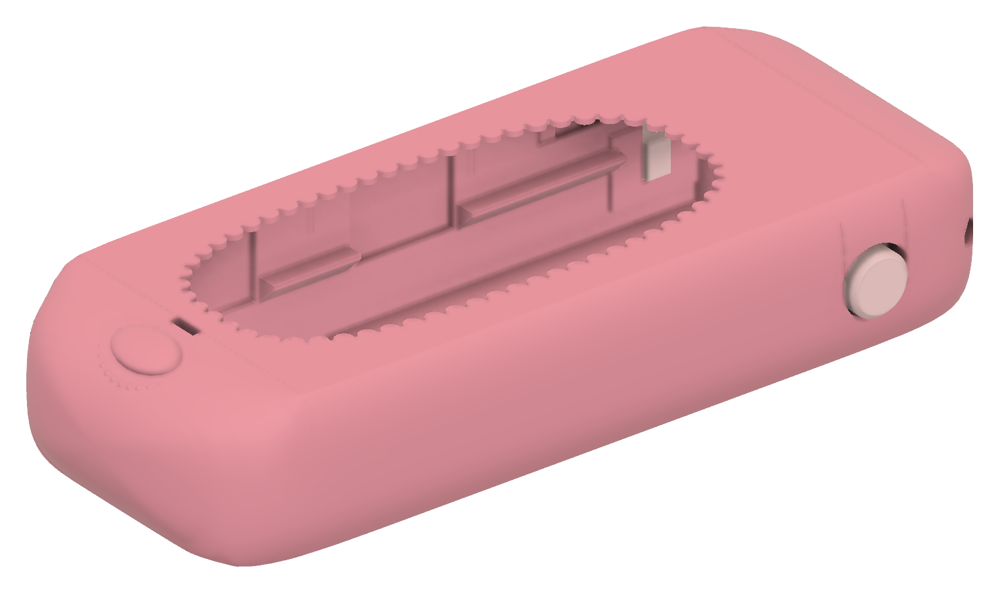
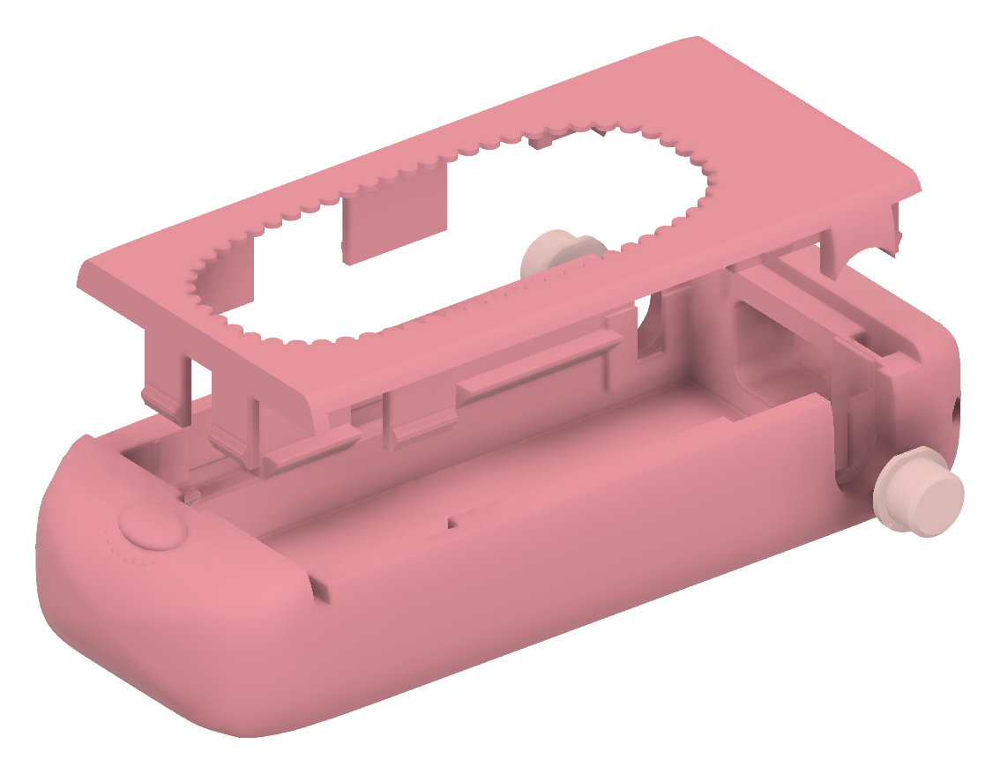
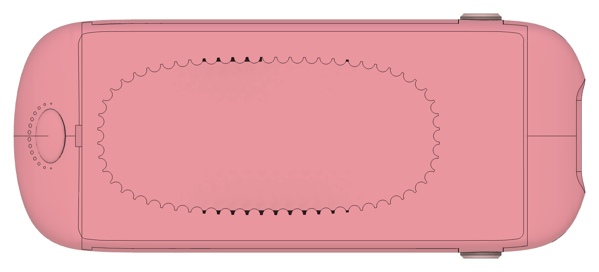
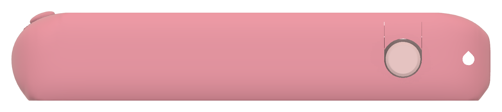

# PixelClip case

A snap-together 3-D printed case that turns a Waveshare **ESP32-S3-AMOLED-1.91** (non-touch) board and a flat
LiPo cell into a hair clip. Four printed parts, no screws, no supports.



| | |
|---|---|
|  |  |



## The parts

| Part | File | Print | What it does |
|---|---|---|---|
| Tray | `stl/pixelclip-case-tray.stl` | 1 | The bottom and the sides. Holds the board on two ledges, centres it with small ribs, and has the USB-C tunnel, the side-key slots and the slots the lid's latches click into. Also carries the domed "jewel" on the far end and two small charm holes at the USB end. |
| Lid | `stl/pixelclip-case-lid.stl` | 1 | The top. An oval window over the screen, ringed with small beads. Barbed latches and two spring bars hang from its underside and click into the tray. Two tabs hold the keys captive. |
| Key A | `stl/pixelclip-case-key-a.stl` | 2 | Captive side key, slimmed 0.10 mm all round. **One notch** on the flange rim. |
| Key B | `stl/pixelclip-case-key-b.stl` | 2 | The same key slimmed 0.16 mm all round: looser. **Two notches** on the flange rim. |

The board has two side buttons (BOOT and RESET), one on each long edge near the USB end. Each key sits in a pocket
inside the tray wall, its face sticking out through a slot, and its inner bar (the pusher) rests on the button's
plunger. The lid's tabs come down over the keys and stop them falling out. Each case needs **two keys of the same
variant**, one per side; the key is the same part on both sides (turn it round).

**Choosing A or B.** Print two of each (they are small). Fit two A keys first. If a key binds or does not spring
back once the lid is on, swap that side for a B key. Key A is the tighter fit; key B leaves 0.06 mm more
clearance all round for prints that come out slightly fat.

### Assembly order

1. Drop a key into the pocket on each side of the tray, face outward through the slot, pusher pointing in.
2. Lower the board (cell taped underneath) in, display up, USB-C toward the tray's USB opening.
3. Put the lid on and press it straight down until the latches click all round.
4. Press each key: you should feel the board's button click.

To open it again, use the fingernail notch at the far end, where lid and tray meet.

## Size and material

- Assembled outside: about **79.8 × 32.7 × 15.0 mm** (length × width × height, measured on the STEP models; the
  height includes the jewel, the flat top-to-bottom height is 14.76 mm). The key faces stand about 0.8 mm proud
  of each side, so about 34.3 mm across the keys.
- Material: **PETG**. PLA is not recommended (snap latches and heat).

## Print settings that worked for us

Printer: a Bambu Lab X2D with a 0.4 mm nozzle, Bambu PETG Matte, sliced in Bambu Studio. One plate with the
tray, the lid and two of each key.

| Setting | Value |
|---|---|
| Orientation | As in the STL files, which are already placed for printing: **tray floor down**, **lid face down** (the top surface on the plate), **keys face down** (the round outer face on the plate). |
| Layer height | **0.16 mm** (first layer 0.20 mm). The key and latch fits were tuned at this layer height; other heights round the small gaps differently. |
| Walls | **6** |
| Infill | **40 % gyroid** |
| Top / bottom shells | 6 / 4 layers (the stock 0.16 mm profile) |
| Supports | **None.** Everything that hangs over air is within 45° of vertical; the only bridge is the roof of the USB cove. |
| Brim | None |
| Plate | **Textured PEI** recommended: the small keys print face down and have come unstuck from a smooth plate. Smooth PEI at 70 °C has also been used; if you use it, watch the keys during the first layers. |
| Nozzle | 258 °C (250 °C first layer) |
| Bed | 70 °C |
| Part cooling fan | 15–35 % (slower than the stock PETG profile, for stronger layer bonds); 100 % on overhangs and bridges |
| Bridges | flow 1.0, 15 mm/s |
| Outer wall speed | 120 mm/s |
| Seam | aligned |
| Time and filament | Slicer estimate for the whole plate: about **53–59 min** and **17.5 g** (tray, lid and four keys). |

The 6 walls and 40 % infill (earlier test prints used 3 walls and 15 %) are there for drop strength: they make
every thin wall around the keys solid perimeters. These stronger settings have **not** been drop-tested.

The STL files carry no slicer settings. If your slicer offers to "auto-orient", say no.

## Fit-critical dimensions (do not change when remixing)

All in mm, in the board frame used by the STEP files (see "Editing the design" below). These are the numbers the
fit depends on; most are tuned to a real board and cell, and to 0.16 mm layers in PETG.

| What | Value | Why it matters |
|---|---|---|
| Board channel | 58.4 × 24.9 (the 58.0 × 24.5 board plus 0.2 clearance per side) | Locates the board; the case is fitted to its outline to about 0.2 mm. Small ribs stand 0.15 into the channel to centre it. |
| Board stack | 13.46 from the top of the glass to the bottom of the taped cell, plus 0.15 left for tape | Sets the floor height. A thicker cell holds the lid open. |
| Floor / rails over the screen | 0.6 / 0.5 thick | Thin on purpose; the whole case is 14.76 tall. |
| Tray/lid split | 3.2 above the lowest face of the display module | The latches, tabs and key pockets are all placed from it. |
| Key axis | Z −3.05, X 54.10 (on the button plungers) | Lower the keys and the pushers miss the buttons. |
| Key fit | 0.15 clearance in slot and pocket, 0.5 free travel inward, key slimmed 0.10 (A) or 0.16 (B) | 0.06 slimming was tried and bound. |
| Lid tab over the key shaft | 0.45 gap (modelled play 0.74–0.80) | 0.9 gave about 1.2 mm of rattle; 0.1 printed as no play at all. |
| Lid tab to the key flange | 0.6 | Smaller and the keys seize. |
| Key pusher | 2.5 wide, Z −5.8 to −2.4 | Overlaps the button plunger by at least 1.35 whether the board sits high or low in its tolerance. |
| Latches | 0.9 thick, barb 0.6 deep, 30° lead-in, 45° catch, 0.1 clearance to the slot face, 0.2 slot clearance; spring bars 0.7 thick | Tuned for PETG; stiffer or more brittle plastics will not click the same way. |
| USB-C tunnel and cove | tunnel 13 × 8 (R1.5), cove for the plug's moulded head 16 × 10 (R3), centred 12.25 / −3.07 | A plug with a very large head may not seat fully (not tested with many cables). |

## Known limits

- **The lid's oval window covers the corners of the screen.** The window is a rounded oval (a superellipse,
  exponent 3) ringed with 60 beads. Laid over the board's 536 × 240 picture it hides about **6.3 %** of the pixels
  (the original design notes say "about 6.4 %"; we recomputed 6.28 % from the window and bead dimensions). Almost
  all of that (97 %) is in the four corners, within about 100 × 60 px of each corner; the rest is the bead
  scallops along the top and bottom edges. The top and bottom rows of pixels are visible only from about x = 85 to
  x = 450. **The PixelClip firmware and app draw to the full rectangular 536 × 240 panel**, so anything they put
  in the extreme corners is behind this lid. Keep text and important detail inside the oval when you design
  content for this case. *Assumption behind the figure:* the lit area (44.22 × 19.80 mm) and its position on the
  board come from the board's CAD model, not from a measurement of a real panel, and the board can sit up to
  0.2 mm off centre in its channel.
- **Only the non-touch ESP32-S3-AMOLED-1.91** fits. The touch version is a different size. The board must have
  **no pin headers** (or have them removed).
- **The cell** must be thin: the case leaves 13.46 mm (+0.15 mm for tape) from the top of the glass to the
  bottom of the cell, and the model's 6.0 mm cell already uses most of that. Measure your board and cell
  together before printing.
- **Strength:** not drop-tested with the settings above. PETG at these sizes is fairly tough but the latches and
  the thin walls around the keys are the weak points.
- **No hair-clip mount** is modelled. How the clip attaches is up to you; keep any clip spring from pressing on the
  cell.
- **No opening** for a power switch, the TF card slot or anything else on the board beyond USB-C and the two
  buttons.
- The fits were tuned on one printer (the X2D above) in PETG. Fits this tight depend on your printer's
  calibration; the two key variants are the built-in allowance for that.

## Editing the design

### STEP files (`step/`)

`pixelclip-case-tray.step`, `-lid.step`, `-key-a.step` and `-key-b.step` are the exact solids the STL files
were made from. Open them in any CAD program (Fusion, FreeCAD, Onshape, SolidWorks, ...). They are placed
**as assembled**, not as printed, in the board frame:

- origin at the corner of the display module, X along the long edge with the USB-C end at high X, Y across the
  board, Z up out of the display;
- both key files sit on the low-Y side; the second key is the same part turned 180° about Z around (X 54.10, Y 12.25).

`pixelclip-case-shell.step` is a bonus for remixers: the solid outer skin (the whole smooth outer shape, before
the tray and lid were cut from it and before any openings). Use it to restyle the outside: intersect a new
shape with it, or replace it and re-cut the parts.

The files are written in centimetres (your CAD program converts on import). They carry a placeholder material
("Steel") from the exporting program; ignore it, and ignore any mass it computes.

### The parametric generator (`source/pixelclip_case.py`)

The parts were generated by a Python script for **Autodesk Fusion**. Every fit number in the table above is a
Fusion user parameter. To use it:

1. Open a **new** design in Fusion.
2. Run the script from *Utilities > Scripts and Add-Ins*, or paste this into Fusion's Python console:

   ```python
   import adsk.core, adsk.fusion
   des = adsk.fusion.Design.cast(adsk.core.Application.get().activeProduct)
   exec(open("/path/to/pixelclip_case.py").read()); build(des)
   ```

   It takes about a minute (most of it lofting the outer shell) and creates the components Shell, Tray, Lid,
   Key A and Key B.
3. Change parameters under *Modify > Change Parameters*, then run `build(des)` again to regenerate.

Checked by the project when the parts were released (not independently repeated): run as published in a new
Fusion design, it reproduces the released parts. The keys come out with
identical volumes, the tray B-rep volume is within 0.04 %, and meshes of the regenerated tray and lid are within
0.02 % of the released meshes' volume and within 0.015 mm of their surfaces.

### How the STL files were made

From the STEP solids in Fusion (custom mesh refinement: surface deviation 0.003 mm and 3° normal deviation for
the tray, 0.002 mm and 2° for the lid and keys), then rotated into print orientation and set on Z = 0. Each mesh
was checked against a much finer mesh of the same solid: closed and manifold, volume within 0.025 %, surface
within 0.012 mm.

## Licence and no warranty

The case files in this folder (the STL and STEP files, the generator script in `source/` and the renders) are
released under the project's [MIT licence](../LICENSE), like the rest of PixelClip.

They come with **no warranty of any kind**, including fitness for a purpose and safety. In particular, nothing here
promises that a printed case will protect or safely hold a lithium cell, survive a drop, or stay closed in use;
see "Known limits" above and the safety notes in [`../docs/BUILD.md`](../docs/BUILD.md#safety). You print, assemble
and wear it at your own risk.
